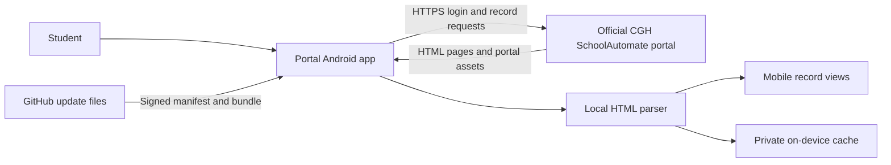

# Architecture

This document describes the production Android path. Local web preview uses a development proxy because browser CORS rules prevent the same direct requests.

## Main data flow

There is no maintainer API in the production path. The app is a client of the official portal and a consumer of public, signed update files.

## Application layers

### Interface

`App.tsx` owns the small screen-state model: login, dashboard tabs, selected portal module, offline mode, and session-expiry state.

Reusable views live under `src/components/`. The record screens favor grouped cards and paged sections because the portal's original wide tables do not fit comfortably on a phone.

Theme constants live under `src/theme/`. Safe-area handling is provided by `react-native-safe-area-context`, while Android keyboard resize behavior is set in `app.json`.

### Portal client

`src/services/cghPortal.ts` contains the known official routes and the two-step login flow. It keeps cookies in a JavaScript `Map` for the active process. Cookies are attached to official portal requests but are not written to AsyncStorage.

After login, the app sends the portal's keep-alive request roughly every 55 seconds while the session is active. A logged-out portal page changes the app to expired-session/offline mode rather than showing a raw server response.

The client intentionally exposes only read paths. There are no methods for enrollment changes, account changes, payments, grade changes, or form submission.

### Parsing

`src/utils/portalParser.ts` converts returned HTML into the shared structures in `src/types.ts`. Portal pages vary in layout, so parsing includes text cleanup, label normalization, and module-specific grouping.

Parser tests in `scripts/test-portal-parser.ts` use synthetic HTML. Real student HTML does not belong in test fixtures or issue reports.

### Offline cache

`src/services/portalCache.ts` stores the last successfully parsed student summary and module records in AsyncStorage. Cache keys contain a schema version so a parser change can stop older malformed data from being shown.

The cache is best-effort. A storage failure does not block live portal use. Cached records are marked as saved copies in the interface and may be stale.

### Android networking

React Native requests use the native OkHttp client. `plugins/withAndroidDnsFallback.js` configures encrypted DNS resolution for the official portal, with Android system DNS as a fallback. This handles providers that return an unusable DNS result for the portal.

The HTTPS request still goes directly to `automate.cghc.edu.ph`. DNS-over-HTTPS changes name resolution; it is not an HTTP proxy and does not receive the student's portal credentials or returned records.

### Updates

`src/ota/` checks version-scoped update pointers in the public download repository. A release workflow signs the exact manifest bytes with Ed25519.

Before a bundle is selected, the app checks:

1. the manifest signature against the public key embedded in the APK;
2. the OTA channel and installed app version;
3. a strictly increasing bundle number;
4. an HTTPS download URL on an allowlisted GitHub host;
5. the declared and downloaded size, with a 40 MB limit; and
6. the downloaded bundle's SHA-256 digest.

The native updater retains earlier bundles and can return to a retained or embedded bundle after a startup failure. Native code, dependencies, Android configuration, and permissions cannot be changed through OTA; those require a newly signed APK.

## Development-only proxy

`scripts/portal-proxy.ts` exists for browser preview and local device work. Browsers cannot call the portal directly because its response does not permit the required cross-origin requests.

The proxy:

- runs on the developer's machine;
- keeps temporary portal client instances in memory;
- is enabled only when a development environment sets `EXPO_PUBLIC_CGH_PROXY_URL`; and
- is not configured in production Android builds.

It is not designed or deployed as a public multi-user service.

## Error handling

Low-level network, DNS, timeout, and OTA errors are mapped to short user-facing messages. Technical details remain useful in local developer logs, but they are not rendered on production login or update screens.

If a live module request fails, the app prefers the latest cached copy when one exists. Authentication failures do not silently open another student's cached summary because the saved student ID must match the entered ID.

## Third-party dependency patches

`patch-package` applies the reviewed files in `patches/` after `npm ci`. They currently cover release compatibility and updater recovery behavior that is not yet available in the compatible upstream packages.

These patches are part of the effective source. A dependency upgrade must check whether each patch is still needed, refresh it when necessary, and run a native release build.
